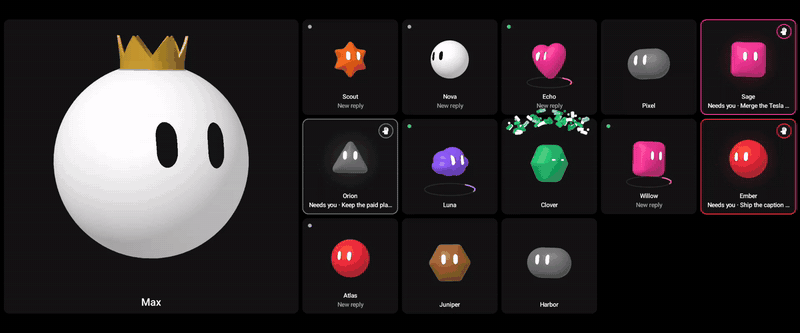
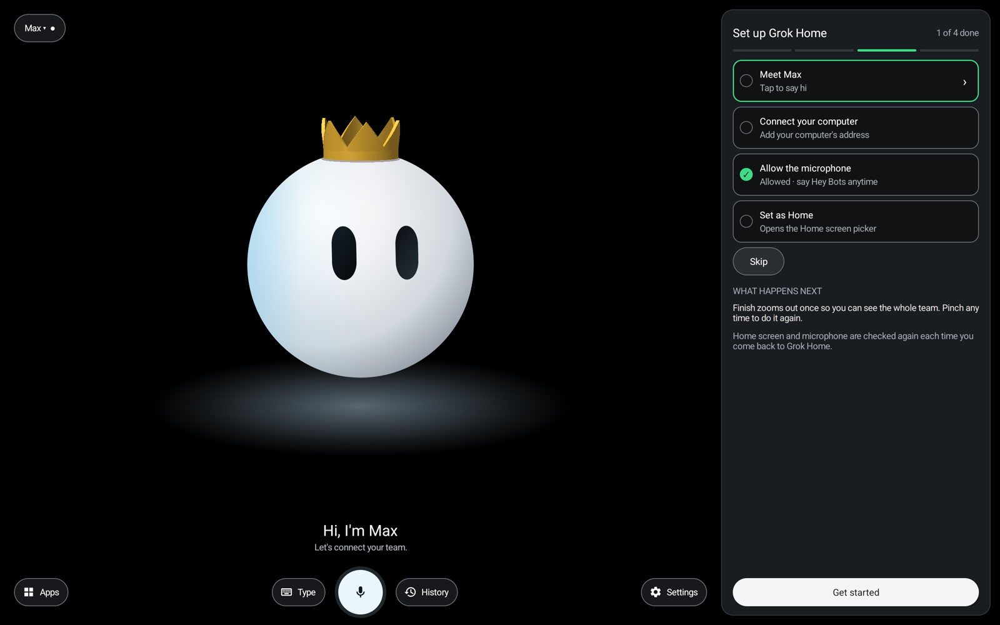

# Android Grok Home

An unofficial native Android home launcher with animated bot avatars, voice and text conversations, and a computer-side bridge to **your own existing Grok Bots** through Cursor BDK.

This is a standalone APK. Installing it does not flash firmware. Android 11 or later is required. This project is independent of xAI, Cursor, Samsung, and Google. No bots, accounts, keys or conversations are included: you bring your own.



<sub>The ambient wall in **Demo mode** (Settings > Demo mode), which shows every state without contacting any bot. The bots are the built-in example roster. [Watch the full-quality MP4](docs/media/demo.mp4).</sub>

<p align="center">
  
  
</p>

<sub>Left: a single bot with its working ring and chat. Right: the guided first-run setup.</sub>

## Set it up with an AI agent

Point your coding agent (Claude Code, Codex, Cursor, or similar) at this repository and say:

> Read AGENTS.md and set up Grok Home for me. Ask me for anything you need.

[AGENTS.md](AGENTS.md) is written for agents: a read-only preflight (`python3 scripts/doctor.py`), the exact commands in order with what to expect, what the agent must ask you for (your bots' exact names, how your device connects, the Cursor sign-in), and what it must never do (message your bots to "test", expose ports, commit secrets). A person can follow it just as well.

## Features

- Animated avatars and a swipeable bot carousel, with stage appearance controls.
- Ambient wall: your whole team at a glance, with working rings, "needs you" hands, unread dots and finish confetti. Settings > **Demo mode** shows every state without contacting any bot.
- Per-bot chat history, drafts, unread indicators, and foreground activity summaries.
- Android speech recognition and text-to-speech, task progress, and cancellation. Optional offline "Hey Bots" wake word.
- Optional private remote access through Tailscale, with a connection sheet that explains what is wrong in plain language.
- A private APK update server.
- A roster tool: add or remove your bots from one list and everything stays in step.

## Build

Install JDK 17 and an Android SDK with platform 34 and build tools. Set `ANDROID_HOME`, or create an ignored `local.properties` containing `sdk.dir=/absolute/path/to/android-sdk`. Then check the machine:

```sh
python3 scripts/doctor.py
./gradlew assembleDebug
```

The debug APK is `app/build/outputs/apk/debug/app-debug.apk`. Debug builds are for development; keep your own signing key private if distributing release builds. The optional wake-word model is fetched with `python3 scripts/fetch-wake-model.py` (about 40 MB, checksum-verified); without it everything else works.

## Configure your own bots

Install Node.js 22.13 or later and Python 3.10 or later. The repository ships with an **example roster** (Max, Scout, Nova, ...). These are not real bots; replace them with yours. From the repository root:

```sh
cd backend/bot-bridge
npm ci
npx bdk login            # you complete the browser sign-in
cd ../..
```

List your bots by their exact names (the first one is the primary: crown, big wall tile, voice shortcuts) and let the tool update every place the roster lives:

```json
[ {"name": "Alice", "color": "blue", "shape": "sphere"}, {"name": "Build Bot", "color": "orange", "shape": "hexagon"} ]
```

```sh
python3 scripts/roster/sync_roster.py my-bots.json           # dry run
python3 scripts/roster/sync_roster.py my-bots.json --apply
```

See [docs/ROSTER.md](docs/ROSTER.md) for colors, shapes, removing bots and shipping an update. Verify names in your account before sending anything: an unknown name may cause the upstream service to create a bot.

```sh
bash scripts/start-bot-bridge.sh
python3 backend/server.py --enable-bots --disable-xai
```

The bridge listens on loopback port 8790; the gateway defaults to loopback port 8787. For an emulator or a USB-connected device, use `adb reverse tcp:8787 tcp:8787`. Open the app settings and set the computer connection address for your environment. The default address is loopback and does not point to someone else's computer.

See [connection setup](docs/SETUP.md) for Windows, LAN, Tailscale and optional xAI voice instructions, and [bridge details](backend/bot-bridge/README.md).

## Tests

```sh
python3 -m unittest discover -s backend -v
cd backend/bot-bridge
npm test
cd ../..
./gradlew testDebugUnitTest
```

These use synthetic fixtures and do not send messages to live bots. The Android unit tests assert against the example roster, so after you replace it some wall, carousel and needs-you tests will fail; that is expected. Live microphone quality and account-specific routing require your own device checks.

## Security and limitations

Keep BDK port 8790 on loopback. LAN mode trusts the configured private network; use it only on a trusted network. For remote access, use private Tailscale Serve with restrictive tailnet access policies. Do not expose the gateway or BDK with public port forwarding or Tailscale Funnel.

The native activity reader uses undocumented Cursor desktop APIs and internal BDK imports. It may break when upstream interfaces change. The adapter is isolated from the regular send/check path. Users supply their own account access; no provider credentials are included.

Local credentials, bot configuration, build outputs, diagnostic dumps, and signing keys are ignored by Git. Never upload real conversations, login state, or private device captures. Patched transitive dependencies are pinned through npm overrides; see [SECURITY.md](SECURITY.md) for the current audit status and OAuth upgrade notes.

## License

MIT; see [LICENSE](LICENSE). Third-party dependencies retain their own licenses. Grok and other product names belong to their respective owners.
